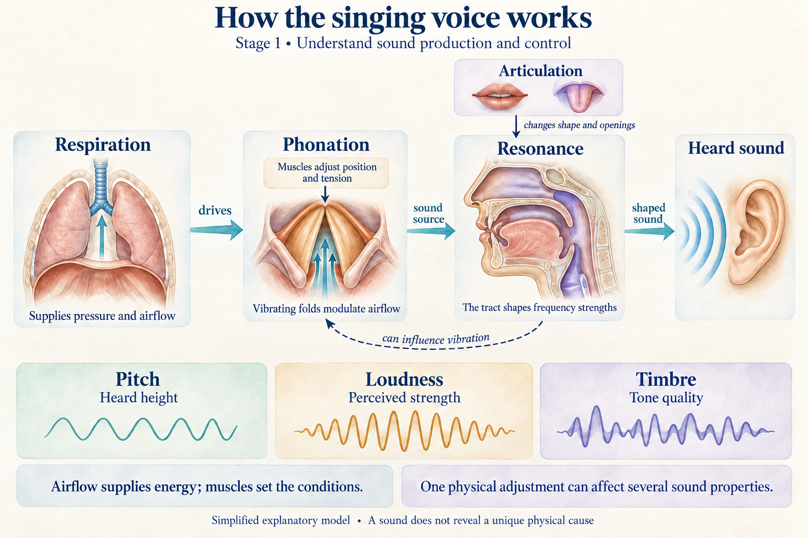

# Learning notes

## Key takeaway

Keep the starting point, current assessment and supporting stage evidence distinct, so the learner can understand progress and resume the next lesson.

## Summary

This guide describes private learning notes for a small goal or a programme with many stages. The overview carries the current position; the initial assessment preserves starting evidence; stage notes connect knowledge, actual responses, feedback and summaries. Plain Markdown is sufficient. The existing optional JSON record describes attempts and its checker detects inconsistent declarations; neither layout is a validated measurement model or an automatic mastery system.

## Programme continuity

The [master Practice](../practices/ai-assisted-learning-orchestration.md) includes a complete plain-text resume record, so JSON and separate files are optional. Existing `plan_id`, `plan_version`, `learning_stage_id` and `learning_task_id` connect an attempt to the programme when those records exist. No new required schema fields are introduced. Keep the overall target, stage decisions and task attempts distinct, and never fill a learner response merely to complete a template.

## Stage summaries and private storage

Keep completed learning notes outside every public repository. Start with an overview and a `stages/` folder. Copy the [overview template](../templates/learning-notes/learning-notes.md) and [stage template](../templates/learning-notes/stages/01-stage-name.md) together, preserving their relative layout:

```text
singing/
  learning-notes.md
  stages/
    01-voice-production.md
    02-pitch-relationships.md
  images/
    voice-production-overview.png
```

These are illustrative private paths. Create a stage file when work begins; future stages can remain roadmap entries. Create `images/` when an image is available. No separate initial-assessment file, file per lesson or history folder is needed by default.

| Location | What belongs here |
|---|---|
| Overview goal | What the learner wants to do, preferences and relevant constraints |
| Overview Starting point | Initial self-assessment, actual baseline evidence and conditions, and what remains unknown |
| Overview Learning stages | Provisional capability roadmap, stage order and links to files that exist |
| Overview Where I am now | Dated current assessment with evidence links, important gaps and the next action |
| Numbered stage file | Stage purpose, lesson outline, important learner-written notes with distinct feedback, and a final connected summary |
| Images folder | Pictures embedded beside their stage summaries, with source or generation provenance retained |

Use two-digit prefixes and descriptive lowercase filenames, such as `01-voice-production.md` and `02-pitch-relationships.md`. The number shows the current learning order, not a score or permanent identity. If the route changes, rename affected files and repair roadmap, evidence and image links together. Preserve existing stable stage IDs when used; do not reuse an ID for a different capability. Record consequential route changes briefly in the overview or affected stage rather than creating a mandatory history folder.

**Be flexible about presentation; be precise about meaning and evidence.** The templates provide an example structure: adapt headings, order, lesson count and depth, and choose prose, bullets, tables or pictures where useful. Replace the prompts with natural notes and remove the opening instructions from the finished copy.

Preserve the initial evidence and meaningful original responses as current understanding develops. Keep planned lessons distinct from completed learning, learner contributions distinct from coach explanations and feedback, and demonstrated understanding distinct from untested capabilities. State the assistance received so an assisted response is not presented as independent performance. These distinctions need to remain clear in the writing; they do not require fixed headings or labels.

The small frontmatter declaration supports this repository's checker and can be removed from private copies. A truly small standalone goal can use sections in one file, but the overview plus `stages/` is the default for continuing learning. A domain organizes subject knowledge; a stage develops a capability and can connect several domains or revisit an earlier one.

## Initial and current assessment

Put the **initial assessment** in the overview under **Starting point**, after the goal and before the learning stages. It preserves the starting evidence under the original goal and conditions. Distinguish a learner's self-report from an observed answer, and record actual assistance, answer exposure, the checking criterion and verification basis. Missing baseline evidence stays not assessed. Do not reconstruct an earlier answer from what the learner can explain after instruction.

Keep this starting point after teaching; do not overwrite it with current ability. A separate initial-assessment file is only useful if substantial existing evidence needs its own space; link it from Starting point instead of duplicating it.

The **current assessment** under **Where I am now** in the overview is a dated interpretation of available evidence, organized by relevant capabilities rather than whole-domain scores. For each useful conclusion, state what is supported, link to the actual observation and help conditions, and name the important uncertainty or next step. A compact table can compare starting evidence, current evidence and remaining gaps, but prose is equally valid. Not assessed, assisted success, independent immediate performance, delayed retention and practical application must remain distinguishable.

Update the current assessment at a stage boundary or when meaningful evidence changes the next decision, not after every conversational turn. Keep previous consequential judgments and their reasons in the relevant stage notes while the overview shows the latest position. If an earlier judgment or answer key was wrong, add a dated correction explaining why and update the current conclusion; preserve the original response and mark the earlier interpretation as superseded rather than silently rewriting the evidence. If the goal or criterion changes, record the new scope and avoid comparing unlike assessments as if they measured the same capability.

For example, in a hypothetical record, a correct response after a hint supports assisted performance. A later correct application without answer help can support a new, bounded current conclusion; it does not turn the first response into an independent baseline. Neither observation supplies delayed retention unless the timing and relevant conditions were actually observed. This example contains no learner results.

## Useful notes within a stage

Name the stage's capability and link to the relevant knowledge domains or Models. Begin with a short numbered lesson outline, giving each lesson a useful purpose rather than prewriting all future questions. Revise it as learning develops. Below the outline, keep important learner-written explanations, questions and attempts, with useful teaching notes and clearly distinguished coach feedback. Keep lessons in the stage file; do not create a file for every lesson. Separate the connected explanation supplied during teaching from the evidence produced by the learner:

- Summarize useful mechanisms, examples and boundaries in enough detail to understand the lesson later; link to canonical explanations instead of copying entire Models.
- Preserve meaningful original answers with their question or task, criterion, actual help and feedback. A faithful excerpt or clearly labeled summary is acceptable when it preserves the reasoning needed to assess the response. Retain exact wording when interpretation depends on it. Do not save every conversational turn by default.
- Record an assisted correction or later attempt separately. An explanation supplied by the coach is teaching, not a learner response.

At the stage boundary, add a connected synthesis and one checked overview picture, what the actual evidence supports, remaining gaps and the next stage's purpose. Mark a pause or provisional transition explicitly. The summary is not a replacement for its supporting observations or a mastery certificate. Additional pictures are optional.

In a stage file such as `stages/01-voice-production.md`, embed the image with ``. In a single root-level record, the relative path is `images/voice-production-overview.png`. Check the actual image exists and keep its essential meaning in text. Reuse a suitable subject illustration or create one with available tools, retaining provenance. If an image or private saving destination is unavailable, supply the text in the conversation and state the limitation; do not claim an asset or saved record exists.

## Singing example

This is an illustration of how to use the templates, not a completed learner assessment. Replace the placeholders privately with actual evidence. The proposed lessons below are a starting route, not a fixed curriculum.

**Overview:** The goal might be to understand how the singing voice works before applying it to singing. Starting point contains the learner's own self-assessment and any actual baseline response; otherwise write “not assessed.” The roadmap can begin with **01 Voice production** and provisionally continue to **02 Pitch relationships**. Where I am now links to the current stage and records only supported conclusions and the next action.

**Stage 01 Voice production:** Aim to explain how respiration, phonation, vocal tract resonance and articulation interact, and distinguish pitch, loudness and timbre without inferring a unique physical cause from one sound change.

A possible lesson outline is:

1. **Sound properties:** distinguish pitch, loudness and timbre using contrasting examples.
2. **Producing and shaping sound:** connect respiratory drive, vocal-fold vibration and the vocal tract.
3. **Coordination and limits:** reason about a vowel change or a change in volume, and explain what the observation cannot establish.

Below that outline, keep **learner notes** such as “[my explanation or question, in my own words]” with enough task context to interpret them. Follow with separately identified **coach feedback**, actual assistance and any later revision. Leave missing replies unrecorded. This public example intentionally contains no learner answers or performance conclusions.

A final **summary** could connect the knowledge like this:

Respiration supplies the pressure conditions and airflow that power voiced sound. Muscle activity sets conditions for vocal-fold vibration; airflow and tissue interact to sustain it. The tract shapes the relative strengths of frequency components, and articulation changes its shape and openings. Pitch, loudness and timbre are distinct perceptual properties, although physical adjustments can influence more than one. A changed timbre alone does not establish a changed fundamental frequency or identify exactly how the folds moved.



This schematic summarizes knowledge, not measured anatomy, a recorded signal or learner competence. Its explanation follows the inspected material recorded in [Voice Acoustics](../references/wolfe-garnier-smith-2009-voice-acoustics.md). The original AI-generated illustration is reused with its [generation prompt](../diagrams/singing-voice-production-overview.prompt.txt). In private notes, copy the picture to `images/` and embed it from the stage file using `../images/voice-production-overview.png`.

End the stage summary with **what the actual replies support, what remains untested and the next step**. These remain placeholders until evidence exists. Conceptual explanation alone does not demonstrate practical singing control or delayed retention.

## Feed useful gaps back into knowledge

A recurring question or unclear explanation can identify a reusable improvement. Note the missing distinction, mechanism, example or boundary, then check it against suitable sources before changing the owning subject file. Coaching-process improvements belong in AI Coach. A learner's difficulty motivates inspection; it does not establish a scientific claim or prove that the document is wrong.

When an authorized knowledge update is complete, link the note to the improved explanation. Preserve the original learning evidence and distinguish the later explanation from what was available at the time. Keep personal answers and assessments private; promoting a reusable explanation does not authorize publishing the learner record.

## Optional structured records

A plain private note is sufficient. If structured JSON is useful instead, use the existing optional record:

1. Copy data/session-record-template.json outside the public repository.
2. Specify the goal, task and criterion. Keep identifiers local and avoid unnecessary personal information.
3. Create a separate attempt when help or feedback changes the conditions. Never overwrite the original response with the revision.
4. Leave unobserved events and unknown fields blank. Do not turn a missing response into a numerical failure.
5. Run python3 tools/check_record.py /path/to/private-record.json to inspect declarations. Do not upload the private file to an AI service unless appropriate.

For a multi-episode goal, keep the [planning record](learning-workflow.md) logically separate from observations, as sections in the same private Markdown file or separate existing records. Reference a plan version and stable learning-stage ID in your private note. The plan holds intended activities; this session record holds actual responses and assistance. Neither a plan edit nor a checked map link changes the original performance record.

## Link a single task to its plan when available

The optional `learning_task_id` identifies the bounded task currently being attempted, whether or not a formal plan exists. Optional `plan_id`, `plan_version` and `learning_stage_id` can relate this private observation to the corresponding plan version and stable learning-stage ID. If a stage link is supplied, a plan ID and version are required; these are declarations, **not** proof that the referenced plan or task actually exists. Omit the fields or leave them `null` for standalone learning tasks. A learner may produce several attempts for one task, each preserving its real help and conditions.

Use the [lesson and task guide](learning-workflow.md) to select an immediate observable output and criterion. The checker validates identifier shapes and observation declarations, but cannot inspect or certify an external private plan or infer mastery from one success.

## Assistance and verification

answer_help records actual answer assistance as none, hint, partial_solution, full_solution or unknown. access_accommodations is separate. Independent means no answer-generating help during the attempt under the declared resources, not absence of all technology or prior learning. The same item can have been seen before; that affects interpretation and is reported separately.

verification_basis can be none, ai_only, source_checked, deterministic_check or human_review. A checked flag requires a locator describing the actual verification basis; the schema does not prove that inspection occurred. An AI-only judgment remains unverified. Criterion judgments may be meets, does_not_meet, uncertain or not_evaluated; they are not universal grades.

## Timing and changed context

Use actual timestamps and elapsed days when known. A future plan is not a delayed observation. The checker reports unknown timing rather than inventing it. A context_change description identifies what differs; it does not prove far transfer or general competence.

## Outputs and limits

The report counts planned, missing, observed and unchecked attempts. It never calculates a learning-effect size or declares mastery. Data validation does not verify truth, prevent all re-identification or establish a causal effect. The supplied template has no observed learner response, and tests contain constructed records, not user data.
