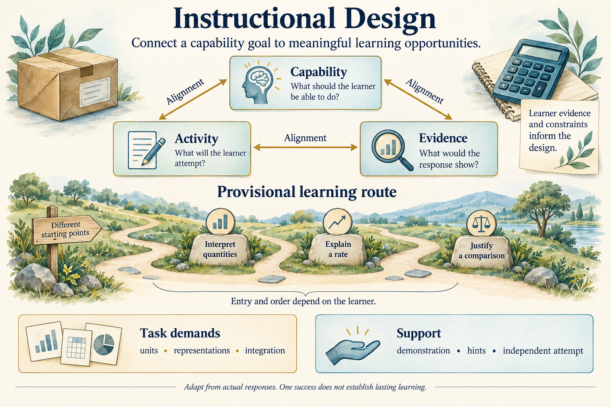

# Instructional Design

## Key takeaway

A learning design connects the intended capability, the activity and the evidence of success. Its route is a proposal informed by the learner and revised when actual responses or circumstances justify change.

## Summary

This Model explains how goals, content, tasks, support and evidence constrain one another. It covers capability alignment, task analysis, prerequisites, sequencing, task demand and adaptation through a constructed unit-price example. It is a KPS-authored integration of selected published contributions, not a universal instructional algorithm. Coaching actions and prompts remain in the [master Practice](../practices/ai-assisted-learning-orchestration.md).

The triangle expresses mutual alignment rather than a three-step sequence. The route below it is an example that can have different entry points. Original illustration generated with the built-in image generation tool; [generation prompt](../diagrams/instructional-design-overview.prompt.txt). All relationships needed to interpret it are explained below.

## Contents

- [Capability objectives and alignment](#capability-objectives-and-alignment)
- [Task analysis and meaningful integration](#task-analysis-and-meaningful-integration)
- [Prerequisites and corequisites](#prerequisites-and-corequisites)
- [Sequencing and learning progressions](#sequencing-and-learning-progressions)
- [Task demand support and practice](#task-demand-support-and-practice)
- [Adaptation from evidence](#adaptation-from-evidence)
- [A connected design example](#a-connected-design-example)
- [Interfaces with other domains](#interfaces-with-other-domains)
- [Limits and unresolved coverage](#limits-and-unresolved-coverage)
- [Source alignment](#source-alignment)
- [Evidence status](#evidence-status)

## Capability objectives and alignment

A **capability objective** describes what someone should be able to explain or do in a relevant situation. “Read about rates” names an activity; “justify a price comparison when package quantities differ” names a capability. A **criterion** specifies what would count as an adequate response: for this example, correct quantities and units, a valid comparison, and an explanation of its relevance.

The [Assessment Triangle](assessment-triangle.md) connects an account of competence, observations elicited by tasks, and interpretation. Our design representation extends that alignment to learning opportunities:

| Element | Question | Consequence of a mismatch |
|---|---|---|
| Intended capability | What should become possible for the learner? | A topic label alone leaves success ambiguous |
| Learning activity | What reasoning or action will the learner perform? | Watching a solution may omit the independent reasoning sought |
| Evidence and criterion | What would a response warrant concluding? | A correct choice alone may conceal a mistaken explanation |
| Conditions | Which sources, tools, assistance and constraints apply? | A supplied answer can be mistaken for independent performance |

These elements constrain each other. A calculator can remove arithmetic burden while preserving the goal of interpreting a rate. If unaided division is the goal, the same tool changes what the response can establish. Neither condition is universally better; its relevance depends on the capability.

## Task analysis and meaningful integration

**Task analysis**, as used here, identifies the knowledge, decisions and actions a particular performance requires. It is a local analysis, not an assertion that the task has one scientifically established decomposition. Cognitive Apprenticeship distinguishes domain knowledge from strategies for solving, monitoring and learning; this helps keep a task description from reducing expertise to isolated facts. [Source record](../references/collins-brown-holum-1991-cognitive-apprenticeship.md).

For the price comparison, demands include reading package quantities, recognizing unlike units, converting where needed, calculating a rate, and explaining which criterion the rate answers. The integration matters: correct conversion and division do not establish that someone knows when unit price is the relevant comparison.

Decomposition changes the question being practiced. “Convert 600 g to kilograms” isolates a demand. “Choose and justify the lower unit price” integrates demands. The smaller task can clarify a difficulty, but completing it does not substitute for the integrated capability. “Smallest meaningful task” is therefore a contextual design judgment, not a fixed number of words, concepts or minutes.

## Prerequisites and corequisites

A **prerequisite** is preparation claimed necessary before a specified task under specified conditions. A **corequisite** is a capability developed alongside another. Helpful background is broader than either. The claim needs a reason tied to the activity; proximity in a subject outline does not supply one.

In a task requiring conversion from grams, interpreting the gram–kilogram relationship is necessary unless the conversion is supplied. If both packages are already labeled in kilograms, that particular conversion need disappears. If the capability is interpreting a rate with a calculator, fluency in manual decimal division need not precede it.

This explains why a dependency can change when the task or support changes. Interpretation and calculation can also develop together through meaningful examples. A provisional route should not turn every useful concept into a compulsory earlier course. Conversely, removing a genuine demand without recording the help can exaggerate what a successful response demonstrates.

## Sequencing and learning progressions

Cognitive Apprenticeship proposes orienting learners to the whole task and varying complexity and diversity, while providing support where needed. These dimensions can guide selection without becoming a fixed lesson order. The [published framework](cognitive-apprenticeship.md) retains its identity; the particular route below is our application.

For the example, an initial complete comparison establishes why rates matter. A learner may then examine the unit conversion, explain one rate, and return to a comparison. Another learner may already handle those operations and need a changed criterion, such as a budget limit. More variation is not automatically more useful: changing units, presentation and criterion together makes it harder to identify the source of an error.

The NRC's school-science account uses **learning progression** for research-grounded descriptions of increasingly sophisticated understanding over time, allowing interacting paths. A plausible adult lesson order is not that evidence. This Model therefore calls its output a **provisional learning route**. [Source context and limits](../references/national-research-council-2007-learning-progressions.md).

## Task demand support and practice

Task demand is relational: it depends on the activity, available knowledge and allowed support. No single difficulty score follows from the number of steps. In the constructed example, unfamiliar units can add a demand while a familiar package context makes the purpose easier to interpret.

| Design change | What changes in the activity | What remains to be checked |
|---|---|---|
| Supply converted masses | Removes conversion from the current attempt | Whether conversion can later be performed when required |
| Demonstrate a different comparison | Supplies an example of the reasoning | Whether the learner can apply it to a fresh case |
| Ask why division is appropriate | Emphasizes the meaning of the quotient | Whether the calculation and resulting units are also understood |
| Change the purchase criterion | Requires interpreting the decision, not just repeating arithmetic | Whether the old rate remains relevant to the new goal |

The IES overview includes spacing, alternating worked solutions with problem solving, and retrieval. These are relevant design considerations, not an optimized schedule for this learner. A demonstration, an immediate attempt, and a later attempt answer different questions. Plans can include opportunities for later use without labeling the current response as retained knowledge. [Inspected recommendation scope](../references/pashler-2007-organizing-instruction.md).

Access accommodations should remain available under the agreed capability. Reducing answer-generating help does not justify removing a screen reader or other access support.

## Adaptation from evidence

Adaptation connects an observation to a reason for changing a design. It is not simply making every successful task harder or every unsuccessful task easier. A wrong answer can arise from ambiguous wording, a mistaken criterion, a missing relationship, or an unchecked AI solution. The interpretation has to be examined before its instructional implication follows.

For example, comparing £0.005/g with £4.50/kg numerically suggests a unit mismatch. Repeating elementary division may leave that relationship untouched. Correctly calculating both rates but choosing the lower package price may instead indicate confusion about the criterion. These are competing interpretations of hypothetical responses, not diagnostic labels or observed learner results.

The [Assessment and Feedback Model](assessment-and-feedback.md) explains how to bound such inferences. The design consequence can be another example, clarification, altered support, a changed task or a revised route. The master Practice chooses one next action with the learner; this Model does not prescribe a universal adaptation policy.

## A connected design example

The proposed goal is: **justify the lower price per kilogram for two comparable products**. Package A costs £3 for 600 g; package B costs £4.50 for 1 kg. The checked result is A at £5/kg and B at £4.50/kg. B has the lower unit price, while A has the lower package price. These invented values are instructional examples.

A provisional route contains three capabilities: interpret quantities, explain a rate, and justify a comparison. These names describe what the learner may become able to do, not three domains to finish. The activity can integrate all three; the starting point depends on evidence.

| Hypothetical evidence | Design implication | Limit of the inference |
|---|---|---|
| Learner explains 600 g = 0.6 kg and the meaning of £/kg | A fresh integrated comparison may be useful | Self-report alone would not supply this observation |
| Learner computes 3 / 0.6 correctly but cannot explain the quotient | Interpretation of the rate deserves attention | Repeating the same calculation may not expose understanding |
| Learner justifies B correctly with a supplied worked solution | The supported activity succeeded | Independent use remains unobserved |
| Learner explains a fresh comparison without answer help | Evidence supports performance on that task | Later retention and wider transfer remain unobserved |

A fresh example could compare £3 for 750 g with £4.50 for 1 kg. The first now costs £4/kg and has the lower unit price. Changing which package wins makes “always choose the larger package” insufficient. The example demonstrates a design rationale; it does not establish the best assessment instrument or prove learning.

## Interfaces with other domains

[Knowledge Representation](knowledge-representation.md) supplies the subject relationships being taught. Learning and cognition concerns the processes that a design tries to support. Motivation and self-regulation contributes the learner's goals, constraints and choices. Instruction and scaffolding concerns the help delivered during an activity. Assessment supplies interpretable observations; memory and transfer extends the outcomes across time and contexts. Human–AI interaction constrains what help and verification are available. Evaluation asks whether the design produced useful effects under appropriate comparisons.

## Limits and unresolved coverage

This introductory synthesis addresses the outline's six topics without covering the whole discipline of instructional design. Formal task-analysis methods, accessibility design, domain-specific sequencing evidence, optimization and broader design frameworks need deeper treatment. No optimal task size, mastery score, pacing schedule or prerequisite graph is established. The evidence supporting the named frameworks does not automatically validate our integration, adult AI adaptation or numerical example as an intervention.

## Source alignment

- [Collins and colleagues](../references/collins-brown-holum-1991-cognitive-apprenticeship.md): Content, Method and Sequencing inform the account of strategies, supported participation and meaningful task order.
- [NRC assessment](../references/national-research-council-2001-assessment.md): Chapter 2, pages 44–51, supports coherence among competence, observation and interpretation. Our capability–activity–evidence presentation extends this to design.
- [NRC learning progressions](../references/national-research-council-2007-learning-progressions.md): Chapter 8, pages 214 and 220–222, bounds progression terminology; it does not validate this adult route.
- [IES overview](../references/pashler-2007-organizing-instruction.md): recommendations 1, 2 and 5b identify selected practice considerations. Full-guide and underlying-study review is not claimed.

The integration, conditional prerequisite examples, task comparison and adaptation analysis are authored here. They are not a jointly published theory or an automated tutor specification.

## Evidence status

Provisional source-grounded explanatory synthesis. The arithmetic and internal design reasoning can be inspected, but no adult learner outcomes, independent scientific review or validated AI implementation are claimed.
